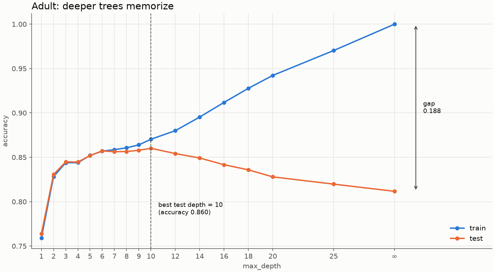
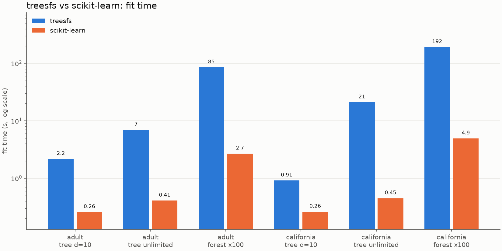
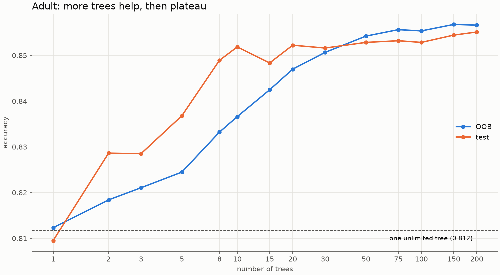
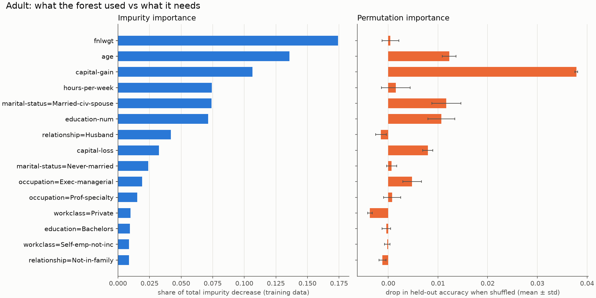

# treesfs

Decision trees (CART) and random forests from scratch in NumPy: an O(n)-after-sort split search, trees stored as flat arrays, out-of-bag evaluation, permutation importance, and head-to-head benchmarks against scikit-learn.

[](https://github.com/RRI-Atharv37/trees-from-scratch/actions/workflows/ci.yml)




## What this is

I built a CART classifier and regressor, then a random forest on top of them, using nothing but NumPy for the models, to see exactly where a tree's speed, its overfitting and a forest's error reduction come from. The core trick is that every candidate threshold of a sorted column is a *prefix*, so the impurity of all of them falls out of one `cumsum`, with no Python loop over samples. The figure above is the first payoff: on Adult, test accuracy peaks around depth 10 while training accuracy keeps climbing to 1.0. Averaging 100 unlimited-depth trees removes most of that overfitting without any depth limit, though on Adult it still does not beat one well-tuned shallow tree (below).

> **Learning project.** Not production software, and not for decisions about people. Read the [disclaimer](#disclaimer-and-legal) before using or reusing anything here.

## Results

**Against scikit-learn** (same data, same seed; best-of-3 wall time for trees, one run for forests; full table with predict times in [reports/results.md](reports/results.md), raw numbers in [reports/benchmark.csv](reports/benchmark.csv)):

| Dataset | Model | treesfs test | scikit-learn test | treesfs fit | scikit-learn fit |
|---|---|---|---|---|---|
| Adult (accuracy) | tree, `max_depth=10` | 0.8601 | 0.8603 | 2.18 s | 0.26 s |
| Adult | tree, unlimited | 0.8117 | 0.8098 | 6.99 s | 0.41 s |
| Adult | forest, 100 trees | 0.8528 (OOB 0.8553) | 0.8517 (OOB 0.8539) | 85 s | 2.7 s |
| California (R²) | tree, `max_depth=10` | 0.6590 | 0.6677 | 0.91 s | 0.26 s |
| California | tree, unlimited | 0.5820 | 0.6016 | 21 s | 0.45 s |
| California | forest, 100 trees | 0.8001 (OOB 0.8063) | 0.8014 (OOB 0.8063) | 192 s | 4.9 s |

The models are as accurate as scikit-learn's, up to tie-breaking, and **3.5x to 47x slower to fit**. That gap is the honest cost of doing it in Python: most of my runtime is NumPy call overhead (roughly one `argsort` and one `cumsum` per node and feature), where scikit-learn runs compiled loops over an in-place partition. Forest fits use all 24 cores of my machine on both sides; treesfs `predict` is single-threaded. Timings are noisy: the same Adult forest fit took 85 s in the benchmark and 151 s in a later single `train.py` run on the same machine, so treat the ratios as the result, not the seconds ([setup](reports/results.md)).



**One tree vs many.** Overfit single trees are high-variance; averaging cures most of it without a depth limit. On Adult, one unlimited tree scores 0.812 on the test set, a 100-tree forest of equally unlimited trees 0.853, and 200 trees 0.855. That is still slightly *below* the depth-10 tree (0.860), and scikit-learn's forest lands in the same place (0.852), so on this small, noisy tabular task a tuned shallow tree is as good as a forest. On California the picture flips: forest R² 0.800 against 0.659 for the best depth-limited tree and 0.582 for an unlimited one. The out-of-bag score, which uses only training rows, tracks the test score closely (Adult 0.857 vs 0.855 at 200 trees; California 0.806 vs 0.800 at 100), so it is a usable free validation estimate.



**Impurity importance can mislead.** `fnlwgt`, a census sampling weight, ranks **first** by impurity importance (17.4% of the total decrease) because it is nearly continuous and always offers some split that lowers *training* impurity. Shuffling it on held-out data costs 0.0004 ± 0.0017 accuracy, i.e. nothing. `capital-gain` is what the forest really relies on (3.8 points when shuffled). Caveat: permutation importance splits credit among correlated features and shuffling one one-hot column creates invalid rows, so read it as a check, not as truth.



**Depth sweep, single trees** ([reports/depth_sweep.csv](reports/depth_sweep.csv)):

| Dataset | Model | Train | Test | Depth | Leaves |
|---|---|---|---|---|---|
| Adult (accuracy) | `max_depth=10` | 0.8703 | **0.8601** | 10 | 260 |
| Adult (accuracy) | unlimited | 1.0000 | 0.8117 | 49 | 4,679 |
| California (R²) | `max_depth=10` | 0.8228 | **0.6590** | 10 | 780 |
| California (R²) | unlimited | 1.0000 | 0.5820 | 34 | 15,804 |

## How it works

For a node $t$ with rows $S_t$, a split $(j,\tau)$ sends row $i$ left iff $x_{ij}\le\tau$. Classification uses Gini $1-\sum_k p_k^2$ or entropy $-\sum_k p_k\log_2 p_k$; regression uses variance. The best split maximizes

$$\Delta I = \tfrac1N\big[N_t I(t) - N_L I(L) - N_R I(R)\big],$$

which is the same as minimizing the *children cost* $N_L I(L)+N_R I(R)$. After sorting a column once, the left child of the $i$-th threshold is the first $i$ rows, so class counts (or target sums) are prefix sums and the cost of all $m-1$ thresholds is one vectorized expression, e.g. for Gini

$$\text{cost}_i = \Big(n_L-\tfrac{\lVert c_L\rVert^2}{n_L}\Big)+\Big(n_R-\tfrac{\lVert c_R\rVert^2}{n_R}\Big).$$

Trees grow depth-first with an explicit stack into seven flat arrays, and prediction advances all samples one level at a time. Concavity of the impurities gives $\Delta I\ge 0$, which is why an unlimited tree reaches zero training error and overfits.

**Forest.** Each of $B$ trees trains on a bootstrap sample and looks at $\sqrt d$ random features per node (all $d$ for regression); predictions are averaged. If tree errors have variance $s^2$ and pairwise correlation $\rho$, the average has variance $\rho s^2 + (1-\rho)s^2/B$: bagging and feature subsampling shrink $\rho$, more trees shrink the second term, which is why the curve above flattens. A row is missed by a given tree with probability $(1-1/n)^n\to e^{-1}\approx0.368$, so averaging only the trees that never saw it gives the **out-of-bag** prediction. **Permutation importance** of feature $j$ is $\text{score}(X) - \text{score}(X \text{ with column } j \text{ shuffled})$ on held-out rows.

Derivations, stopping rules, seeding scheme and correctness evidence: [docs/DESIGN.md](docs/DESIGN.md).

```python
from treesfs import RandomForestClassifier, export_text, permutation_importance

rf = RandomForestClassifier(n_estimators=100, oob_score=True, n_jobs=-1, random_state=0)
rf.fit(X_train, y_train)
print(rf.oob_score_, rf.score(X_test, y_test))
imp = permutation_importance(rf, X_test, y_test, n_repeats=5, random_state=0)
```

## Quickstart

```bash
uv sync
uv run python scripts/download_data.py --dataset all
uv run python scripts/train.py --dataset adult --max-depth 10
uv run python scripts/evaluate.py --dataset adult
uv run python scripts/train.py --dataset adult --model forest      # about 1-3 minutes
uv run python scripts/evaluate.py --dataset adult --model forest
uv run python scripts/depth_sweep.py          # overfitting curve + small_tree figures
uv run python scripts/n_trees_sweep.py        # score vs number of trees
uv run python scripts/importance.py           # impurity vs permutation importance
uv run python scripts/compare_reference.py    # benchmark vs scikit-learn (about 10 minutes)
uv run python -m pytest                       # add `-m slow` for the real-data checks
```

Everything is seeded from `configs/default.yaml`; results do not depend on `n_jobs`.

## Project structure

```text
src/treesfs/
├── criteria.py        # gini / entropy / squared error + vectorized children cost
├── splitter.py        # O(n)-after-sort scan, max_features, brute-force reference
├── models/tree.py     # TreeArrays, DecisionTreeClassifier / Regressor
├── models/forest.py   # bagging, OOB, staged scores, RandomForestClassifier / Regressor
├── permutation_importance.py
├── data.py            # Adult (sha256-checked download, parser) + California loaders
├── preprocessing.py   # one-hot encoder with max_categories and "other"
├── export.py          # export_text, export_graphviz, render_dot
├── viz.py             # depth sweep, n_trees, importance, benchmark and tree figures
├── metrics.py  config.py  utils.py
scripts/               # train, evaluate, depth_sweep, n_trees_sweep, importance,
│                      # compare_reference (the only place scikit-learn is a reference)
tests/                 # criteria, splitter vs brute force, trees/forests vs sklearn, data, export
configs/default.yaml   # every knob
docs/DESIGN.md         # the math
reports/               # results.md, CSVs, figures
```

## What I learned

- Ties are everywhere in classification trees, so "same as sklearn" has to mean "same up to ties", checked at each node.
- The O(n) scan works because the costs are functions of prefix sums, not of the rows themselves.
- A single unlimited tree is a high-variance model; bagging 100 of them lifts Adult test accuracy from 0.812 to 0.853 and California R² from 0.582 to 0.800 with no depth tuning. But "forest" is not automatically better than a tuned tree: on Adult the depth-10 tree (0.860) still wins. The OOB score is the free by-product that lets you check this without a held-out set.
- Seeding a forest from one `SeedSequence` spawned per tree makes the result independent of `n_jobs`, which turned "parallel" from a reproducibility risk into a non-issue.
- The most-used feature by impurity (`fnlwgt`) was worthless on held-out data. Importance computed on training data measures what a model used, not what it needs.

More detail, including what broke, in [LEARNING.md](LEARNING.md).

## References

- Breiman, Friedman, Olshen & Stone (1984), *Classification and Regression Trees*.
- Breiman (2001), "Random Forests", *Machine Learning* 45(1), 5-32.
- Strobl, Boulesteix, Zeileis & Hothorn (2007), "Bias in random forest variable importance measures", *BMC Bioinformatics* 8, 25.
- scikit-learn decision-tree and random-forest implementations, used as the reference for comparisons.
- Becker & Kohavi (1996), *Adult*, UCI Machine Learning Repository, [doi:10.24432/C5XW20](https://doi.org/10.24432/C5XW20), CC BY 4.0.
- Pace & Barry (1997), "Sparse spatial autoregressions", *Statistics & Probability Letters* 33(3) (California housing, via StatLib and scikit-learn).

## Disclaimer and legal

- **Educational use, no warranty.** See [DISCLAIMER.md](DISCLAIMER.md). In particular, the Adult models must not be used to make decisions about real people.
- **Third-party software and data** keep their own licenses and are not bundled: see [THIRD_PARTY_NOTICES.md](THIRD_PARTY_NOTICES.md) and [data/README.md](data/README.md). The datasets are downloaded by the scripts from their original sources.
- **Security.** Model files are Python pickles; only load ones you created. See [SECURITY.md](SECURITY.md).
- Not affiliated with scikit-learn, NumPy, the UCI repository or the dataset authors.

## License

MIT, see [LICENSE](LICENSE). The license covers this repository's code and documentation, not the datasets.
